<div align="center">



# 🧬 Awesome Genomic Analysis Tools 🔬

<a href="https://github.com/ishandutta2007/Awesome-Awesome-Awesome"></a>
<a href="https://discord.gg/jc4xtF58Ve"></a>
[](https://github.com/ishandutta2007/Awesome-Awesome-Awesome)
[](https://github.com/ishandutta2007/Awesome-Genomic-Analysis-Tools)
[](LICENSE)
[](CONTRIBUTING.md)
[](https://github.com/ishandutta2007/Awesome-Genomic-Analysis-Tools)
<a href="https://github.com/ishandutta2007"></a>

**A carefully curated directory of leading SaaS platforms and top-starred open-source bioinformatics tools for Next-Generation Sequencing (NGS) data processing, variant discovery, secondary analysis, and clinical genomics pipelines.**

[Market Overview](#-sector-overview--market-dynamics) • [SaaS Platforms](#-saashosted-platforms) • [Open-Source Ecosystem](#-open-source-github-projects) • [Pipeline Architecture](#-bioinformatics-pipeline-architecture) • [Star History](#--star-history) • [Support](#-support) • [How to Contribute](#-how-to-contribute)

</div>

---

## 📖 Introduction & Scope 🌐

Modern high-throughput sequencing instruments (Illumina, Pacific Biosciences, Oxford Nanopore, Element Biosciences, Ultima Genomics) produce gigabytes to terabytes of raw base calls per run. Converting raw reads into clinical answers requires a robust two-stage computational stack:

1. **Secondary Analysis**: Read alignment against reference assemblies (`BWA`, `Minimap2`), duplicate marking, base quality score recalibration (BQSR), and variant calling for SNVs, Indels, CNVs, and structural variants (`GATK`, `DeepVariant`, `FreeBayes`, `DRAGEN`).
2. **Tertiary Analysis & Interpretation**: Variant annotation, pathogenic prioritization, clinical trial matching, and reporting (`Fabric GEM`, `SOPHiA DDM`, `VarSeq`, `Golden Helix`).

Whether you are configuring cloud-native enterprise infrastructure or designing reproducible containerized workflows (`Nextflow`, `Snakemake`), this directory tracks the industry leaders.

---

## 📈 Sector Overview & Market Dynamics 📊

> **Global Market Footprint:** The global **genomics data analysis and bioinformatics software market** is estimated at **$26.8 billion to $38.5 billion in 2026**, on track to exceed **$100 billion by the early 2030s**. Within this ecosystem, the dedicated **Next-Generation Sequencing (NGS) secondary and tertiary data analysis** software niche accounts for **$1.2 billion to $1.7 billion**, compounding at an accelerated rate of **16% to 23% CAGR** driven by routine oncology testing, population-scale biobanks, and cell and gene therapies.

> **Market Fragmentation & Competitive Dynamics:** The sector is **moderately fragmented and operates as a hybrid ecosystem** rather than a winner-take-all monopoly. While upstream sequencing hardware and secondary FPGA acceleration are heavily anchored by industry giants like Illumina and QIAGEN, downstream secondary and tertiary analysis remains decentralized. Clinical genomics demands deep disease-specific specialization (rare diseases vs. liquid biopsies vs. somatic solid tumors), regulatory agility (CLIA/CAP/FDA requirements), and data sovereignty, enabling specialized enterprise SaaS innovators and modular open-source standards to thrive side-by-side.

---

## ☁️ SaaS/Hosted Platforms 🏢

The following hosted and cloud-native solutions deliver turnkey secondary and tertiary genomic analysis, automated compliance, and accelerated compute.

*The table is sorted descending by company size (valuation or market capitalization).*

| Product & Provider | Company Size (Valuation / Revenue) 🏢 | Starting Pricing 💵 | Free Tier / Trial Limits 🎁 | Core Focus & Differentiators 🎯 |
| :--- | :--- | :--- | :--- | :--- |
| **[Illumina DRAGEN](https://www.illumina.com/products/by-type/informatics-products/dragen-secondary-analysis.html)**<br>*(Illumina, Inc.)* | **~$16.5B Market Cap**<br>($4.5B Annual Revenue; NASDAQ: ILMN) | **$15.00/hour** software fee on AWS Marketplace (f1 FPGA instance); or **$5.25/sample** ($\le 7$ GB) / **$10.00/sample** ($> 7$ GB) via cloud BioInsight Credits (BIC) | **30-day free trial** with **1 TB free cloud storage** and promotional BioInsight compute credits (~$100 value); included unmetered onboard NovaSeq X instruments | Ultra-fast hardware-accelerated FPGA pipeline. Achieves **99.89% PrecisionFDA accuracy** and processes a 34x germline whole genome in ~30 minutes. |
| **[BaseSpace Sequence Hub](https://help.connected.illumina.com/basespace)**<br>*(Illumina, Inc.)* | **~$16.5B Market Cap**<br>($4.5B Annual Revenue; NASDAQ: ILMN) | **$500/year** base subscription (Professional tier) + compute from **$0.15 - $0.50/hr** via BioInsight Credits ($1.00/credit) | **Free-forever Basic Account** with **1 TB permanent cloud storage** and free utility apps; new accounts receive a **30-day trial** with compute credits | Native cloud streaming directly from Illumina sequencers, push-button app store, automated run monitoring, and multi-user workgroup sharing. |
| **[QIAGEN CLC Genomics Workbench](https://digitalinsights.qiagen.com/products-overview/discovery-insights-portfolio/qiagen-clc-genomics/clc-workbench-features/)**<br>*(QIAGEN N.V.)* | **~$9.8B Market Cap**<br>($2.0B Annual Revenue; NYSE: QGEN) | **$5,000/year** per seat for academic/commercial desktop licenses; student companion packages from **$79/year** | **14-day fully-functional free evaluation license** (all modules unlocked; extendable upon request); **90-day extended trial** for qualifying benchtop sequencers (<250 GB output) | Intuitive desktop/server graphical interface for end-to-end NGS analysis: de novo assembly, variant detection (SNV, CNV, SV), RNA-seq, and oncology biomarkers (TMB, MSI, HRD). |
| **[DNAnexus Platform](https://www.dnanexus.com/)**<br>*(DNAnexus, Inc.)* | **~$800M Valuation**<br>($320M Funding Raised; Blackstone Growth backed) | Pay-as-you-go from **$0.08/vCPU-hour** and **$0.02/GB-month storage**; managed project entry tiers start at **$1,000/project** | **30-day proof-of-concept trial** with tailored compute credits; UK Biobank RAP instance grants **£40 (~$50) free compute credit** expiring after 90 days | Enterprise multi-omics collaboration cloud compliant with ISO 27001, HIPAA, CLIA, CAP, and FedRAMP. Capable of analyzing 3,000 whole genomes per day. |
| **[Seven Bridges Platform](https://www.sevenbridges.com/)**<br>*(Velsera)* | **~$350M Enterprise Valuation**<br>(~$80M Revenue; Summa Equity portfolio) | Execution-based starting at **$14.10 per Graph WGS run** (~80 GB FASTQ); bring-your-own-cloud compute rates + platform license | **30-day enterprise evaluation trial** with **$100 - $300 in test compute credits**; NCI Cancer Genomics Cloud grants **$300 - $1,000 pilot research credits** | Graph-based whole genome secondary analysis, CWL/WDL workflow orchestration, multi-cloud flexibility (AWS/GCP), and population-scale cohort analytics. |
| **[SOPHiA DDM](https://www.sophiagenetics.com/)**<br>*(SOPHiA GENETICS)* | **~$280M Market Cap**<br>($77.3M Annual Revenue; NASDAQ: SOPH) | Pay-per-analysis model from **$100 to $500 per analysis** depending on gene panel complexity, liquid biopsy depth, and tumor profiling | **30-day clinical validation trial** with up to **10 complimentary test sample analyses** for prospective hospital/clinical laboratory onboarding | AI-native precision medicine platform. Has analyzed over 2 million patient genomic profiles across 800+ healthcare institutions in 72 countries. |
| **[Fabric Enterprise & GEM](https://www.fabricgenomics.com/)**<br>*(Fabric Genomics)* | **~$130M Valuation**<br>($50M Funding Raised; SoftBank backed) | Clinical sample-to-report interpretation from **$1,000/sample**; clinical lab annual subscription tiers starting at **$15,000/year** | **14-day scoped pilot evaluation** with **5 complimentary test case prioritization runs** for accredited clinical laboratories | AI-based variant prioritization (Fabric GEM) cutting manual review by 75%; gold standard for rapid NICU/PICU rare disease diagnosis and clinical WGS/WES. |
| **[Partek Flow](https://www.partek.com/partek-flow/)**<br>*(Illumina / Partek Inc.)* | **~$50M Valuation**<br>(Acquired by Illumina) | Academic lab annual subscription starting at **$3,000/year** (includes 150 GB cloud storage); core facility hourly reservation rates from **$15/hour** | **14-day hosted cloud trial** with full point-and-click workflow access and pre-loaded tutorial datasets | Point-and-click graphical bioinformatics software specialized in single-cell RNA-seq, spatial transcriptomics, bulk RNA-seq, and statistical genomics. |
| **[Genialis Expressions / krasID](https://www.genialis.com/)**<br>*(Genialis, Inc.)* | **~$30M Valuation**<br>($15M Funding Raised; Series A) | Commercial biomarker discovery packages starting at **$10,000/study** for clinical trial cohort stratification | **14-day interactive evaluation access** with pre-indexed public TCGA oncology cohorts and biomarker prediction demos | Machine learning RNA biomarker development platform predicting patient drug response and therapeutic resistance across diverse cancer cohorts. |
| **[SNP & Variation Suite (SVS) & VarSeq](https://www.goldenhelix.com/)**<br>*(Golden Helix, Inc.)* | **~$25M Valuation**<br>(~$10M Revenue; Bootstrapped & profitable) | Single-seat annual licenses starting at **$4,500/year**; or sample-based volume tiers from **$25/sample** | **Free-forever read-only Viewer Mode** for inspecting and sharing VarSeq/SVS project files; **14-day full commercial trial license** with technical onboarding | Desktop and private cloud clinical variant interpretation compliant with ACMG/AMP guidelines, oncologic CNV calling, and population agrigenomics. |

---

## 🔓 Open-Source GitHub Projects 💻

Open-source bioinformatics software forms the computational foundation of modern genomics. These tools allow research labs, core facilities, and biopharma teams to construct transparent, audit-ready, and cost-effective pipelines without proprietary vendor lock-in.

*The list below is sorted descending by GitHub Star Count.*

### 1. 🤖 [Google DeepVariant](https://github.com/google/deepvariant) [](https://github.com/google/deepvariant/stargazers)
- **Primary Focus**: Deep learning-powered variant caller for germline, somatic, and non-human sequencing.
- **License**: BSD-3-Clause
- **Key Features**: Uses convolutional neural networks (CNNs) trained on image representations of aligned reads to call SNVs and small indels. Consistently wins PrecisionFDA Truth Challenges for Illumina, PacBio HiFi, and Oxford Nanopore reads.

### 2. ⚡ [Nextflow](https://github.com/nextflow-io/nextflow) [](https://github.com/nextflow-io/nextflow/stargazers)
- **Primary Focus**: Data-driven computational workflow orchestrator and domain-specific language (DSL).
- **License**: Apache-2.0
- **Key Features**: Seamless abstraction across local workstations, HPC clusters (SLURM, SGE), and clouds (AWS Batch, Google Cloud Life Sciences, Azure). Backed by the vibrant [nf-core](https://nf-co.re/) ecosystem of peer-reviewed pipelines.

### 3. 🐍 [Snakemake](https://github.com/snakemake/snakemake) [](https://github.com/snakemake/snakemake/stargazers)
- **Primary Focus**: Python-native workflow management system for reproducible and scalable data analysis.
- **License**: MIT
- **Key Features**: Rule-based syntax that seamlessly combines Python code with shell commands. Automatic file dependency resolution, native conda/container integration, and cluster execution support.

### 4. 🚀 [STAR Aligner](https://github.com/alexdobin/STAR) [](https://github.com/alexdobin/STAR/stargazers)
- **Primary Focus**: Ultra-fast universal RNA-seq read aligner.
- **License**: MIT
- **Key Features**: Capable of aligning 45 million 2x76bp paired-end reads per hour per processor. Accurately identifies canonical and non-canonical splice junctions, chimeric fusion transcripts, and circular RNAs.

### 5. 🗺️ [Minimap2](https://github.com/lh3/minimap2) [](https://github.com/lh3/minimap2/stargazers)
- **Primary Focus**: Versatile pairwise sequence aligner and mapper for long and short reads.
- **License**: MIT
- **Key Features**: Standard de facto mapper for Oxford Nanopore and PacBio long reads, spliced cDNA/mRNA, and whole-genome assembly comparisons. Extreme computational efficiency with low memory footprint.

### 6. 🏛️ [GATK (Genome Analysis Toolkit)](https://github.com/broadinstitute/gatk) [](https://github.com/broadinstitute/gatk/stargazers)
- **Primary Focus**: Industry-standard variant discovery toolkit from the Broad Institute.
- **License**: Apache-2.0
- **Key Features**: Gold-standard Best Practices pipelines for germline short variants (`HaplotypeCaller`), somatic mutations (`Mutect2`), copy number alterations (`GermlineCNVCaller`), and structural variants.

### 7. 🛠️ [SAMtools](https://github.com/samtools/samtools) [](https://github.com/samtools/samtools/stargazers)
- **Primary Focus**: Universal library and utilities for manipulating SAM, BAM, and CRAM alignment files.
- **License**: MIT / Expat
- **Key Features**: Indispensable foundational toolkit providing fast indexing, sorting, filtering, merging, depth calculation, and format conversion.

### 8. 🌌 [Galaxy Platform](https://github.com/galaxyproject/galaxy) [](https://github.com/galaxyproject/galaxy/stargazers)
- **Primary Focus**: Open, web-based graphical scientific workbench.
- **License**: Academic Free License
- **Key Features**: Enables researchers without command-line experience to build reproducible pipelines, run thousands of integrated tools, and share workflows and provenance histories.

### 9. 🧬 [BWA (Burrows-Wheeler Aligner)](https://github.com/lh3/bwa) [](https://github.com/lh3/bwa/stargazers)
- **Primary Focus**: Accurate and fast reference mapping for short sequencing reads.
- **License**: GPL-3.0
- **Key Features**: Home of `BWA-MEM`, the standard aligner used worldwide for Illumina short-read whole-genome and exome sequencing analysis.

### 10. 📊 [MultiQC](https://github.com/MultiQC/MultiQC) [](https://github.com/MultiQC/MultiQC/stargazers)
- **Primary Focus**: Modular aggregate reporting for bioinformatics quality control.
- **License**: GPL-3.0
- **Key Features**: Automatically searches directories for logs and output metrics from over 140 bioinformatics tools, generating a unified, publication-ready interactive HTML report.

### 11. 🕸️ [vg (Variation Graph)](https://github.com/vgteam/vg) [](https://github.com/vgteam/vg/stargazers)
- **Primary Focus**: Pangenomic graph tools for reference variation representation.
- **License**: MIT
- **Key Features**: Replaces linear reference genomes with variation graphs, eliminating reference bias and dramatically improving variant calling in polymorphic, repetitive genomic loci.

### 12. 📐 [BEDTools](https://github.com/arq5x/bedtools2) [](https://github.com/arq5x/bedtools2/stargazers)
- **Primary Focus**: Comprehensive genome arithmetic and interval manipulation engine.
- **License**: GPL-2.0
- **Key Features**: The "Swiss Army Knife" of genomics. Performs set theory operations (`intersect`, `merge`, `subtract`, `coverage`) across BED, GFF/GTF, VCF, and BAM intervals in linear time.

### 13. 🐟 [Salmon](https://github.com/COMBINE-lab/salmon) [](https://github.com/COMBINE-lab/salmon/stargazers)
- **Primary Focus**: Ultra-fast, bias-corrected transcript-level RNA-seq quantification.
- **License**: GPL-3.0
- **Key Features**: Uses quasi-mapping and dual-phase optimization to quantify transcript expression directly from FASTQ files in minutes, accounting for sequence-specific and GC biases.

### 14. ✂️ [BCFtools](https://github.com/samtools/bcftools) [](https://github.com/samtools/bcftools/stargazers)
- **Primary Focus**: High-performance variant calling and VCF/BCF file manipulation.
- **License**: MIT / Expat
- **Key Features**: Companion to SAMtools; provides `bcftools call`, variant normalization, filtering, query expressions, merging, and consensus sequence generation.

### 15. 🎲 [FreeBayes](https://github.com/freebayes/freebayes) [](https://github.com/freebayes/freebayes/stargazers)
- **Primary Focus**: Bayesian haplotype-based genetic polymorphism discoverer.
- **License**: MIT
- **Key Features**: Calls single nucleotide polymorphisms (SNPs), indels, and complex events based on literal read sequence haplotypes without requiring prior ploidy assumptions.

### 16. 🔬 [IGV (Integrative Genomics Viewer)](https://github.com/igvteam/igv) [](https://github.com/igvteam/igv/stargazers)
- **Primary Focus**: Interactive high-performance visualization tool for large genomic datasets.
- **License**: MIT
- **Key Features**: Desktop GUI providing smooth zooming and panning across multi-gigabyte BAM alignments, variant calls, epigenomic tracks, and reference annotations.

### 17. 🔍 [FastQC](https://github.com/s-andrews/FastQC) [](https://github.com/s-andrews/FastQC/stargazers)
- **Primary Focus**: Quality control analysis for high-throughput raw sequence reads.
- **License**: GPL-3.0
- **Key Features**: The standard first step in every NGS pipeline. Reports per-base sequence quality, GC content distribution, duplication levels, overrepresented sequences, and adapter contamination.

### 18. 🧬 [nf-core/sarek](https://github.com/nf-core/sarek) [](https://github.com/nf-core/sarek/stargazers)
- **Primary Focus**: Production-ready Nextflow workflow for germline and somatic variant calling.
- **License**: MIT
- **Key Features**: End-to-end WGS/WES pipeline integrating BWA-MEM2, GATK HaplotypeCaller, Mutect2, Strelka2, DeepVariant, and MultiQC with built-in container and cloud profiles.

### 19. ✂️ [Manta](https://github.com/Illumina/manta) [](https://github.com/Illumina/manta/stargazers)
- **Primary Focus**: Structural variant and large indel discovery for paired and single sequencing samples.
- **License**: GPL-3.0
- **Key Features**: Developed by Illumina; rapidly discovers translocations, inversions, and large deletions from breakends and discordant read pairs.

---

## 🏗️ Bioinformatics Pipeline Architecture 📐

A production-grade genomic analysis workflow typically connects these tools in an orchestrated pipeline:

```text
               ┌───────────────────────┐
               │  Raw Sequencing Reads │
               │   (FASTQ / BAM / CRAM)│
               └───────────┬───────────┘
                           │
             [ Quality Control: FastQC ]
                           │
                           ▼
               ┌───────────────────────┐
               │  Read Alignment       │
               │  BWA-MEM2 / Minimap2  │
               └───────────┬───────────┘
                           │
       [ Post-Processing: SAMtools / Picard ]
                           │
                           ▼
               ┌───────────────────────┐
               │  Variant Calling      │
               │ GATK / DeepVariant /  │
               │ FreeBayes / DRAGEN    │
               └───────────┬───────────┘
                           │
               [ QC Aggregation: MultiQC ]
                           │
                           ▼
               ┌───────────────────────┐
               │  Filtration & VCF Ops │
               │  BCFtools / BEDTools  │
               └───────────┬───────────┘
                           │
                           ▼
               ┌───────────────────────┐
               │ Tertiary Interpretation│
               │ Fabric / SOPHiA / SVS │
               └───────────────────────┘
```

---

## ⚖️ SaaS vs. Self-Hosted Open-Source: Decision Matrix 🧭

| Dimension | 🏢 Enterprise SaaS Platform | 💻 Self-Hosted Open-Source Stack |
| :--- | :--- | :--- |
| **Setup & Maintenance** | Turnkey, zero infrastructure configuration required. | Requires dedicated DevOps, HPC, and bioinformatics engineering. |
| **Data Privacy & Control**| Data hosted on provider cloud/VPC; vendor governance. | 100% on-premises or private cloud sovereignty; zero data lock-in. |
| **Hardware Acceleration** | Proprietary FPGA/ASIC acceleration (e.g. DRAGEN 30 min WGS). | Relies on commodity CPUs/GPUs; configurable parallelization. |
| **Compliance & Audit** | Pre-certified HIPAA, CLIA, CAP, ISO 27001, SOC 2. | Lab must validate pipelines and ensure audit trails independently. |
| **Cost Dynamics** | Predictable per-sample or subscription fees; scales linearly. | High initial DevOps investment; virtually free software license. |

---

## 🤝 How to Contribute 🌟

We welcome high-quality contributions from the bioinformatics and precision medicine community!

1. 🍴 **Fork the repository**.
2. 🌿 **Create a descriptive feature branch** (`git checkout -b add-new-genomic-tool`).
3. 📝 **Add or update an entry** in `README.md`:
   - Follow the established markdown formatting.
   - For SaaS tools: include verified starting pricing, trial limits, and company size.
   - For Open-Source tools: include official shields.io star badge linked to stargazers and concise technical highlights.
4. 🚀 **Commit and push** your changes cleanly.
5. 📬 **Submit a Pull Request** with a brief summary of the changes.

---

##  Star History

[](https://star-history.dera.page/#ishandutta2007/Awesome-Genomic-Analysis-Tools&type=date&legend=top-left)

---

## 💖 Support

Thank you for exploring **Awesome-Genomic-Analysis-Tools**! If this curated ecosystem helps your research, clinical pipelines, or computational workflows, please consider supporting the project:

- ⭐ **Star this repository** to help others discover it.
- 🍴 **Fork and contribute** your favorite pipelines and tools.
- 📢 **Share with colleagues** in the bioinformatics and genomics community.
- ☕ **Buy me a coffee / Sponsor**: Support ongoing maintenance and future updates via the [GitHub Sponsors Dashboard](https://github.com/sponsors/ishandutta2007).

<a href="https://github.com/sponsors/ishandutta2007"></a>

---

## ⚠️ Disclaimer 📋

- This repository is a **community-curated index** intended for educational, technical, and informational purposes. It does not constitute a commercial endorsement or clinical validation.
- **Clinical diagnostic workflows** (e.g., in vitro diagnostics, clinical genetic testing) require validation under appropriate laboratory frameworks (**CLIA**, **CAP**, **CE-IVD**, **FDA guidelines**) prior to reporting patient results.
- Pricing, free tier limits, and corporate valuations fluctuate over time; please verify latest terms directly on vendor official websites.

---

<div align="center">

**Crafted with 🧬 for bioinformaticians, geneticists, computational biologists, and software engineers.**

⭐ Star this repository if it assists your genomic research and pipeline development!

</div>
